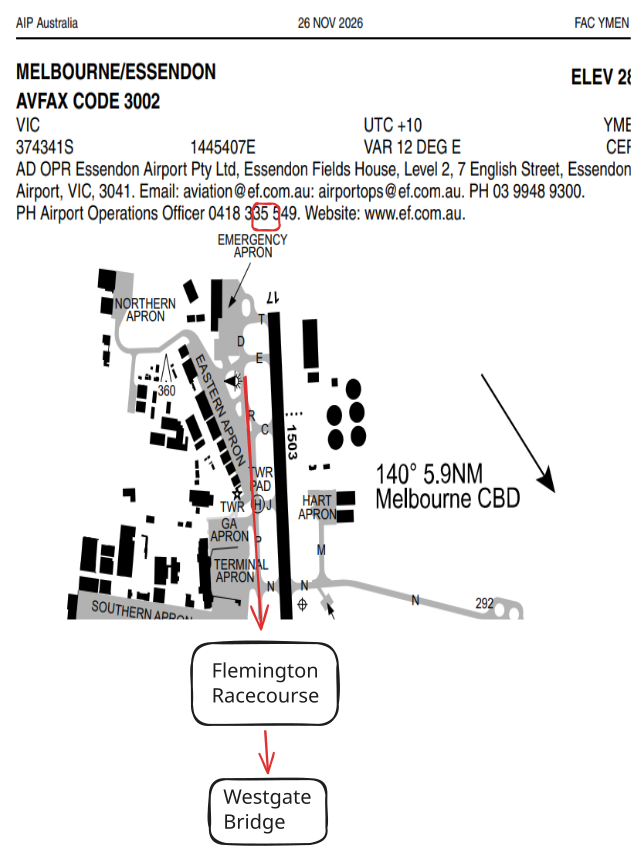
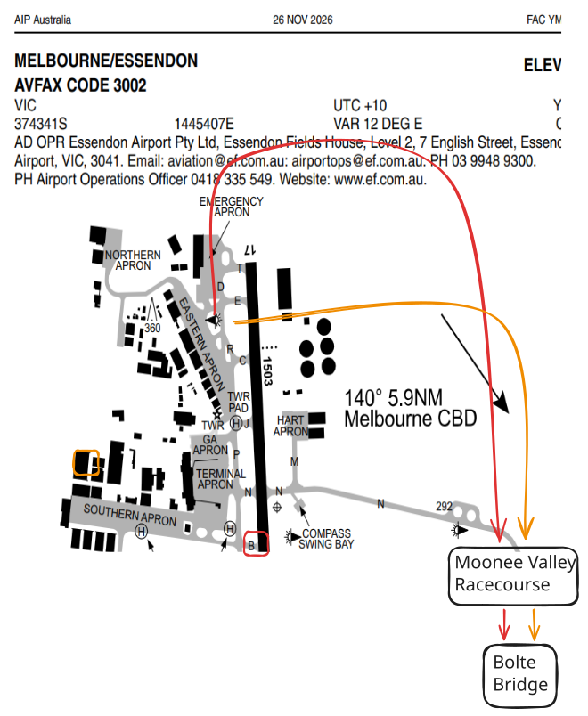

# Essendon Aerodrome

## Departing Essendon

### Essendon Ground Radio Calls

The initial radio call alerts the controller that you need to request an airways clearance without a pre-lodged flight plan, allowing the controller time to prepare to copy down the departure details.

Pilot:
> "Essendon Ground, 
> Helicopter PDV, 
> Departure details."

Ground:
> "PDV, 
> Essendon Ground."

This call establishes ground taxi authorization and provides the outbound VFR airways clearance for the flight. It does not grant takeoff permission.

Pilot:
> "PDV, 
> Hangar 7,
> dual, 
> information India,
> request taxi to Tower Pad,
> airways clearance to Westgate Bridge."

Ground:
> "PDV, 
> taxi to TWR Pad, 
> cleared to Westgate Bridge, 
> not above 1,500."

Pilot:
> "Taxi to TWR Pad,
> cleared to Westgate Bridge, 
> not above 1,500,
> PDV."

### Essendon Tower Radio Calls

Pilot:
> "Essendon Tower, 
> PDV, 
> Tower Pad, 
> ready."

Tower:
> "PDV
> cleared for takeoff."

Pilot:
> cleared for takeoff
> PDV"

This exchange confirms the termination of air traffic control services as you leave controlled airspace.

Tower:
> "PDV, 
> control service terminated."

Pilot:
> Control service terminated,
> PDV."

### Departing Runway 17

### Departing Runway 35 or Runway 08

## Arriving Essendon

### Essendon Tower Radio Calls

This radio call alerts the controller that you need to request an airways clearance without a pre-lodged flight plan, allowing the controller time to prepare to copy down the arrival details.

Pilot:
> "Essendon Tower, 
> Helicopter PDV, 
> Inbound details."

Tower:
> "PDV, 
> Essendon Tower."

Clearance to enter Class C airspace. It does not grant landing permission.

Pilot:
> "PDV, 
> Westgate Bridge 1,500,
> dual, 
> information India,
> request airways clearance to Tower Pad."

Tower:
> "PDV, 
> cleared Westgate Bridge, Flemington Racecourse, Essendon 
> not above 1,500."

Pilot:
> "cleared Westgate Bridge, Flemington Racecourse, Essendon 
> not above 1,500,
> PDV."

Tower will make contact with circuit joining directions and landing clearance. Do not begin descent before being cleared to land.

Receiving "cleared visual approach" from the tower means you are authorized to proceed directly to the aerodrome amd maneuver as necessary for landing. If cleared to follow another aircraft, you are responsible for maintaining visual separation and avoiding wake turbulence.

Tower:
> "PDV,
> join final,
> cleared to land Tower Pad."

Pilot:
> join final,
> cleared to land Tower Pad,
> PDV."

